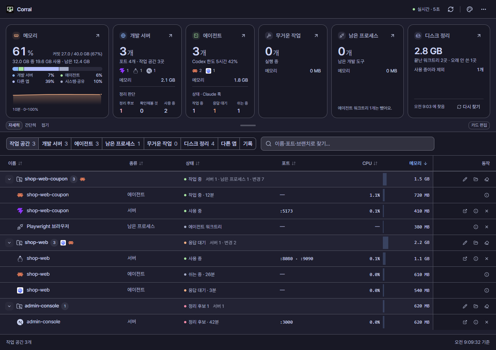
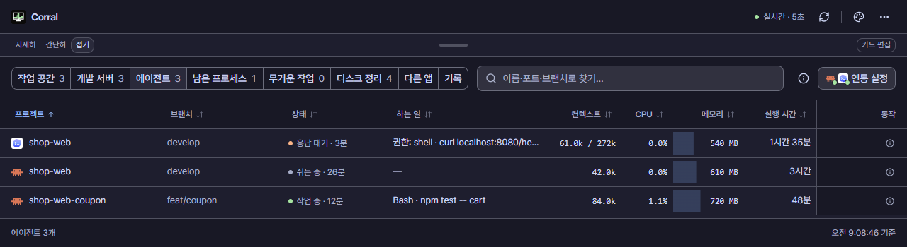
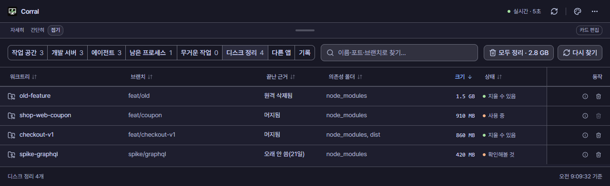

# Corral

Claude Code나 Codex 같은 AI 코딩 에이전트를 여러 워크트리에서 동시에 돌릴 때, 내 PC에서 무엇이 돌고 있는지 한 화면에서 보고 바로 정리하는 트레이 앱이에요.



## 왜 필요한가요

에이전트를 여러 개 띄워 두면 금방 이렇게 돼요.

- 어떤 에이전트가 내 답을 기다리는지 터미널을 하나씩 열어 봐야 알 수 있어요.
- 끝난 작업의 개발 서버와 테스트 브라우저가 계속 메모리를 차지해요.
- 머지하고 잊어버린 워크트리마다 `node_modules`가 몇 GB씩 쌓여요.

Corral은 이것들을 작업 공간(저장소·워크트리)별로 묶어서 보여 주고, 필요 없는 것은 그 자리에서 정리하게 해 줘요.

## 할 수 있는 것

- **에이전트 상태**: 작업 중·응답 대기·쉬는 중·오류, 그 상태가 이어진 시간, 지금 하는 일과 토큰 사용량. 응답을 기다리거나 작업이 끝나면 OS 알림으로 알려 줘요.
- **개발 서버**: 어느 워크트리의 서버인지, 연 포트와 메모리, 연결 수. 오래 아무도 안 쓰면 정리 후보로 표시해요.
- **남은 프로세스**: 에이전트나 터미널이 끝났는데 남아 있는 Playwright 브라우저, 테스트 러너, Gradle 데몬 등.
- **메모리**: 개발 서버·에이전트·다른 앱별로 얼마나 쓰는지(Windows는 커밋까지). 메모리가 모자라면 끌 만한 것을 골라 한 번에 정리해요.
- **디스크 정리**: 머지됐거나 오래 안 쓴 워크트리에서 `node_modules`, `dist` 같은 폴더를 찾아 지워요. 워크트리와 소스 코드는 그대로 둬요.
- **기록**: 최근 24시간 동안 일어난 일. 자리를 비웠다 돌아오면 그 사이 일을 한 줄로 요약해 줘요.





끄거나 지우는 작업은 모두 확인 창을 거치고, 실행 직전에 상태를 한 번 더 확인해요. Corral이 알아서 끄거나 지우는 일은 없어요.

## 설치

[Releases](https://github.com/yeonjin1357/Corral/releases)에서 최신 버전을 내려받아요.

**Windows 10/11**

`corral-<버전>-setup.exe`를 실행하면 관리자 권한 없이 설치돼요. 코드 서명이 없어서 "Windows의 PC 보호" 창이 뜨면 **추가 정보 → 실행**을 눌러 주세요. 그다음부터는 새 버전을 알아서 받아 두었다가 앱을 다시 시작할 때 설치해요.

**macOS** (아직 실제 Mac에서 확인하지 못했어요)

Apple Silicon은 `arm64`, Intel은 `x64` dmg를 받아 응용 프로그램 폴더로 옮겨요. 처음 열 때 경고가 나오면 **시스템 설정 → 개인정보 보호 및 보안**에서 **그래도 열기**를 눌러 주세요. "손상되었기 때문에 열 수 없습니다"가 나오면 터미널에서 아래를 실행한 뒤 다시 열어요. 자동 업데이트는 되지 않아요.

```bash
xattr -dr com.apple.quarantine /Applications/Corral.app
```

설치하면 트레이(메뉴 막대)에 작은 모니터 아이콘이 생겨요. 왼쪽 클릭은 요약 창, 오른쪽 클릭은 메뉴예요.

## 에이전트 연동 (선택)

연동하지 않아도 Claude Code와 Codex가 남기는 세션 파일로 기본 상태는 알 수 있어요. **설정 → 에이전트 연동**에서 연동을 켜면 어떤 도구가 권한을 기다리는지, 지금 무엇을 하는지까지 보여요.

- **Claude Code**: `~/.claude/settings.json`에 훅을 추가해요. 바꾸기 전에 백업을 남기고, 끄면 Corral이 넣은 훅만 빼요.
- **Codex**: `~/.codex/hooks.json`에 훅을 추가해요. 켠 뒤 Codex에서 `/hooks`를 열어 한 번 승인해야 해요.

이미 실행 중인 세션은 다시 시작해야 반영될 수 있어요.

## 개인정보

- 모든 정보는 내 PC 안에서만 읽어요. 인터넷 접속은 새 버전 확인 하나뿐이고, 설정에서 끌 수 있어요.
- 기록에는 종류·시각·폴더 이름·숫자만 남기고, 프롬프트나 명령은 남기지 않아요.
- 정확히 무엇을 읽고 어떤 파일을 바꾸는지는 [docs/details.md](docs/details.md)에 정리해 뒀어요.

## 알아 두면 좋은 점

- WSL2나 Docker 안에서 도는 서버는 어느 워크트리 것인지 알 수 없어서 정리 후보로 올리지 않아요.
- "끝난 워크트리"는 이 PC의 git 정보(마지막 fetch 기준)로 판단해요. Corral이 fetch하지는 않아요.
- 커밋 메모리는 Windows에서만 보여요.

그 밖의 한계와 설정 항목은 [docs/details.md](docs/details.md)에 있어요.

## 개발

```bash
npm install
npm run dev        # 개발 실행
npm test           # 테스트
npm run typecheck  # 타입 검사
npm run lint       # 린트
```

배포는 `package.json`의 `version`을 올리고 같은 이름의 태그(예: `v0.2.0`)를 push하면 돼요. GitHub Actions가 Windows·macOS 설치 파일을 만들어 초안 릴리스에 올리고, 초안을 확인한 뒤 게시하면 설치된 앱들이 새 버전을 받아요.

## 라이선스

MIT. 화면 디자인은 [NeoHtop](https://github.com/Abdenasser/neohtop)(MIT)을 바탕으로 바꿨어요. 가져온 오픈소스 목록은 [THIRD_PARTY_NOTICES.md](THIRD_PARTY_NOTICES.md)에 있어요.

---

**English** — Corral is a tray app for developers running several AI coding agents (Claude Code, Codex) across git worktrees. It groups agents, dev servers, leftover processes and memory use by workspace, and lets you clean them up after a confirmation. Everything is read locally; the only network access is the update check. The UI is in Korean. Windows is tested; the macOS build is not yet verified.
